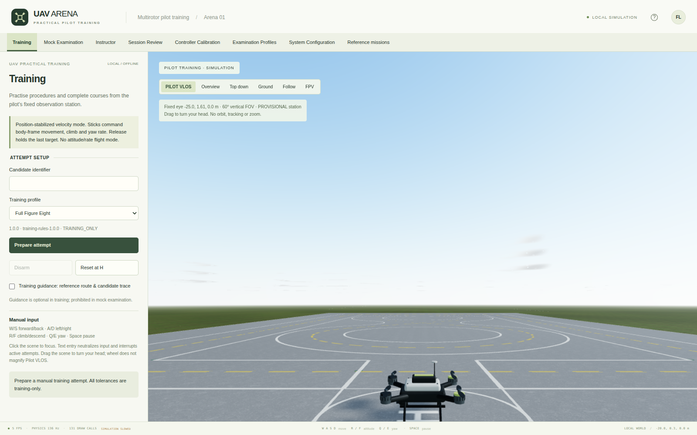

# UAV Arena — Practical pilot training

A local, browser-native multirotor practical-training simulator (v0.2.0). The central court is **45 × 27 m concrete**, surrounded by **60 × 42 m natural turf**. Geometry is traced from the supplied diagram; ancillary facilities are excluded.

## Run

Requires Node.js 22.12+ (verified with 24.15.0), npm and a WebGL2-capable browser.

```sh
npm ci
npm run dev
```

Open the Local URL printed by Vite. It starts at `http://localhost:5173` and selects the next port if occupied. All textures, the original drone GLB and the reference image ship locally. The app needs no account, API key, remote CDN or simulation backend.

```sh
npm run build       # strict TypeScript check + production assets in dist/
npm run preview     # serve the production build locally
npm test            # native Node geometry/physics checks, no browser needed
```

## Manual training and mock examination

The app opens in **Training**, with a fixed **Pilot VLOS** observation camera. The pilot station is provisional, west of H; it is distinct from the aircraft landing location and the examiner area. No official Vietnamese examination profile or certification equivalence is claimed. All numeric scoring tolerances are visibly **TRAINING_ONLY**.

1. In **Controller Calibration**, choose keyboard or an exposed browser gamepad/USB RC simulator adapter. Inspect axes, capture neutral/ranges, set inversion/deadzones and save a named mapping. Mode 2 defaults are provisional; real RC compatibility/latency is unverified. Select a saved mapping, then save it to make it active. Use localhost (or a secure HTTPS origin) for browser crypto/gamepad capabilities.
2. In **System Configuration**, confirm the provisional pilot station/eye height/FOV and weather. Mock conditions lock at preparation. Instructor weather changes during training require pausing the live attempt.
3. Choose candidate/profile, **Prepare attempt**, acknowledge preflight, **Confirm preflight**, **Arm for manual flight**, then **Begin manual task** with neutral sticks. Climb manually with R/F or the calibrated climb channel. There is no automatic climb, route flight or landing in a manual attempt.
4. Complete the observed takeoff/hover and selected complete route or foundations tasks. Figure Eight requires both lobes in order and return to H. Outer Circuit requires the full M1–M5 corridor and H return. Training can show explicit reference/trace guidance; mock examination locks Pilot VLOS and removes those aids. Drag to turn your head; the eye never translates and wheel input never magnifies VLOS.
5. After flight tasks, **Begin manual landing**, descend over H, disarm after contact and wait for stopped motors. Complete postflight and finish. Outcomes require human review; a landing or high practice score alone never produces a pass. Abort, safety stop and input loss remain distinct incomplete outcomes.

Manual mode is **position-stabilized body-frame velocity / climb / yaw-rate**, using the existing 250 Hz PID/motor/force model. W/S follows the aircraft's forward/backward heading, A/D lateral, R/F climb/descent, Q/E yaw. Release holds the resulting target. Attitude/rate flight mode is not implemented. Text entry, window blur or controller loss neutralizes input and interrupts active attempts; click the scene to focus before flying. Buttons and guidance checkboxes remain usable. Space pauses; interruptions remain logged.

**Instructor** and **Session Review** provide live controls, plan/reference and actual 3D trace, recorded telemetry/RC histories, event timeline, replay/scrubbing and separately appended human notes/assessments. Replay uses recorded states and camera poses, not a claimed deterministic aircraft resimulation. JSON/CSV/readable report exports retain provenance (CSV `rate_*_rps` is body angular rate in rad/s; `motor*_rads` is rotor rad/s); JSON includes a SHA-256 payload checksum and appended notes. These are local practice records, not authenticated aircraft/device evidence. Future external telemetry is a read-only manifest boundary; no aircraft command transport exists.

Attempts checkpoint to IndexedDB every 10 simulated seconds and seal on completion/abort. Final records cannot be overwritten through the storage API. An interrupted checkpoint remains visibly incomplete and is not resumed into a pass. Export backups: browser storage can be cleared or quota-limited. Recording is bounded to 600 simulated seconds; JSON imports are limited to 100 MB and validate schema, finite values, timestamps, quaternion and checksum. No account/cloud service is needed; all runtime assets are local.

See [implementation and verification report](docs/IMPLEMENTATION_AND_VERIFICATION_REPORT.md), [rules and scoring](docs/EXAMINATION_RULES_AND_SCORING.md), [standards research](docs/UAV_EXAMINATION_STANDARDS_RESEARCH.md), [pilot station design](docs/PILOT_STATION_AND_VLOS_DESIGN.md), [controller architecture](docs/CONTROLLER_INPUT_ARCHITECTURE.md) and [real-world validation plan](docs/REAL_WORLD_VALIDATION_PLAN.md).



## Reference demonstrations

Select **Reference missions** to use the preserved flight laboratory controls below. Automatic demonstrations remain separate from candidate task evaluation. Navigation into a manual workflow is unavailable while an automatic mission is active; finish or abort it first.

1. Arm motors, then **Take off** for a controlled climb to a 5 m landing-gear altitude. Take off also arms automatically when disarmed.
2. **Hold** captures the current position. **Land** descends and disarms on contact. Disarming in flight removes thrust; it does not freeze the aircraft.
3. While landed at **H**, select **Mission 01 — Figure Eight** or **Mission 02 — Outer Circuit**. Start mission arms, climbs to 5 m, flies one complete course, returns to H, lands and disarms before reporting completion. Figure Eight uses the existing exact circle/tangent course, entered from its westernmost point. Outer Circuit follows M1 → M2 → M3 → M4 → M5, then returns along the left perimeter and H gate. Pause holds while retaining phase/progress; Resume continues. Abort/Hold cancels safely into position hold. Selection is locked during a mission; Reset restores H and retains the selected mission.
4. WASD command world-frame horizontal velocity (W=−Z, D=+X); R/F climb/descend; Q/E change yaw. Commands go through the controller and rotor dynamics. Release keys to hold the resulting position. Space pauses the entire simulation.
5. Reset returns the aircraft to landing zone H. A hard or severely tilted landing triggers crash/disarm; Reset recovers.

Mouse drag/scroll orbit and zoom in Overview, Orbit and Ground. Follow tracks the aircraft; FPV follows its full attitude. Top down includes a 10 m scale bar for reference checks. Flight path, compact engineering labels, collider overlays and the optional distant Context matte can be toggled. Labels retain actual marker positions, use screen-sized text and suppress overlaps. The Context matte is visual only; the simulated grass field remains 60 × 42 m. The model tab exposes RPM, individual thrusts, world position, body rates and local wind.

## Environment and graphics

Six blendable presets: clear skies, partly cloudy, overcast, light rain, heavy rain and wind/gusts. Expand the environment card to adjust wind, direction, gusts, turbulence, cloud cover, rain, visibility and time of day. **Direction is wind towards**, measured from world +X towards +Z. Rain intensity is normalized 0–1, not measured mm/h. Rain affects visuals only.

The same deterministic wind field drives body-relative drag, grass bending, rain slant and slow cloud advection. Sunlight, sky scattering, three stable cloud-height layers, continuous fog/ambient colors, PBR roughness and surface wetness respond to weather. Cloud structures use a seeded filtered noise atlas with no screen-space jitter or per-frame regeneration. Sky/cloud reflections refresh once a weather/time transition settles, rather than on every frame.

Concrete retains the local 2K albedo/normal/roughness maps, now sampled at micro/mid/macro scales. Its shallow 3.5 cm edge includes a 5 mm bevel and narrow soil/contact band; paint sits 1.5–2 mm above the surface with polygon offset. Wet roughness is restrained to avoid a mirror finish.

Turf uses deterministic **world-anchored tiles**: authored Poly Haven tufts in 2 m tiles fade over 2.5–5.5 m; simple three-blade clusters in 4 m tiles fade over 13–23 m; multi-scale PBR turf covers the far field. All representations share weather wind and wetness. Instance transforms never move with the camera. Tile visibility and renderer frustum culling bound work. High avoids broad grass shadow passes; Ultra uses matching wind/LOD depth shaders for tuft shadows. The original airframe GLB and independently spinning rotors are preserved.

Low/Medium/High/Ultra vary pixel ratio, grass density, 1K/1K/2K/4K shadow maps, cloud noise detail and rain particle budgets. All use the same local textures. Software renderers default to Low. The footer reports measured FPS, actual simulated steps per wall second and draw calls. Frame stalls cap catch-up to 100 ms; hidden-tab time is discarded. These presets are quality limits, not universal FPS promises.

## Physics and coordinate convention

- Meters, seconds, kilograms, radians; X follows the 45 m edge, Z the 27 m edge, Y points up. Court center(0,0,0); concrete topY=0, turfY=−0.035.
- Quaternion maps body coordinates to world. Body+Y is rotor thrust, +X is right and+Z is rear. Angular velocity is body-frame; rendered FPV looks body−Z.
- 250 Hz semi-implicit force/velocity/position integration and normalized quaternion integration, independent of renderer cadence. Each motor has lag, quadratic rotor-speed thrust, bounds and alternating reaction torque.
- Cascaded position/velocity→attitude→body-rate PID with output limits and bounded integrals. Gravity, diagonal inertia, gyroscopic torque, rotational damping and body-frame quadratic drag are applied before integration.
- Four landing-foot contacts against finite concrete/turf heights, penetration correction, low restitution and Coulomb friction. Paint, blades and rain have no colliders.
- 15 kg demonstrator parameters are in `src/simulation/parameters.ts`. **Not calibrated to a real aircraft**; no digital-twin, sensor-fidelity or engineering-validation claim.

## Reference and assumptions

The upright reference is `assets/reference/arena-layout.png`. Original JPEG is preserved. `src/arena/arenaGeometry.json` holds dimensions, line widths, boundaries, lobe centers, landing areas and markers. `docs/ASSUMPTIONS.md` records calibration, estimated neck curves/dash spacing, model and collision limitations. V2 is the collection of white corridor boundaries, not a single 38×21 m rectangle. V1 is white 5 cm; V2 white 10 cm; V3 dashed yellow 10 cm. Diagram labels are optional overlays, not oversized painted annotations.

See [ASSET_LICENSES.md](ASSET_LICENSES.md) for CC0 sources and provenance. To restore downloaded maps or regenerate the original airframe:

```sh
python scripts/download-assets.py
node --import tsx scripts/export-drone.ts
```

## Verification

Headless tests cover calibrated dimensions, actual paint widths, analytical figure-eight length, motor/force/contact behavior, deterministic wind, clock cadence, and both complete finite missions. Mission checks include exact M1–M5 ordering, physical corridor containment, phase order, pause/resume, return to H, landing before completion and bounded integrated displacement. Vegetation checks cover reproducible world tiles and stable density prefixes.

Browser validation uses installed Chrome and Playwright:

```sh
# Start a dev/preview server and use its actual printed port.
UAV_URL=http://localhost:4175 npm run test:browser
UAV_URL=http://localhost:4175 npm run test:training-browser
UAV_URL=http://localhost:4175 node scripts/visual-check.mjs
# Optional: CHROME_PATH=/path/to/chrome; UAV_HARDWARE=1 omits forced SwiftShader.
```

The visual matrix opens a fresh browser for environment, temporal and mission sections to bound software-renderer memory. It captures the requested weather, map, ground/grass distances, both previews, H approach, follow/FPV and mobile views. Frozen raw WebGL frames are compared exactly; cloud motion and camera travel have multiple captured frames. For targeted work use `UAV_VISUAL_SECTION=environment|temporal|missions`, `UAV_PAINT_ONLY=1`, or `UAV_VISUAL_QUICK=1`.

Training verification is in `docs/training-browser-evidence.json` and `docs/training-screenshots/`. Headless training checks include complete physically integrated courses using synthetic manual velocity inputs, ordered-gate shortcut rejection, procedure/neutral-input guards, calibration, focus, camera projection and recording/replay/export integrity. Synthetic inputs do not establish human skill or physical RC compatibility.

Earlier environment evidence is saved in `docs/browser-evidence.json`, `docs/visual-evidence.json` and `docs/screenshots/`. The pre-refinement images/evidence are retained under `docs/baseline-*`. Long flight tests advance the same force-based 250 Hz integrator and never assign aircraft XYZ. See `docs/REFINEMENT_REPORT.md` and the latest handoff for measured results and remaining visual limitations.

## Known limits

The reference is a low-resolution drawing: small neck dimensions, exact dash spacing and minor marker placement remain estimates. Ground contact is a simplified height-field/foot model, not full body/propeller collision. Telemetry is ideal simulation state, not noisy sensors. Wetness uses PBR environment reflection/specular response, not planar ray tracing. Clouds use a stable layered approximation and still lack fully convincing volumetric billows at low angles. Grass is world anchored, but closeups still expose texture/geometry differences; full photorealistic acceptance remains open. The optional visual context matte has no facilities, colliders or vegetation instances outside the official field. Hardware GPU performance is unverified.

This is an implemented simulator undergoing visual acceptance, **not a claim that every photorealism criterion is met**. Check the latest `AGENT_HANDOFF_CONTEXT.md` for actual build/browser evidence, remaining gaps and exact next actions.
