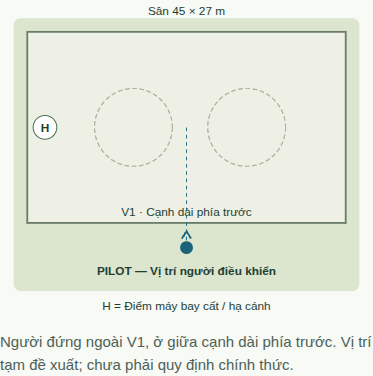

# Pilot station and VLOS design — v0.3.0

## Authoritative geometry and front-edge interpretation

The upright original is `assets/reference/arena-layout.png`; concrete/V1 is 45×27 m, world X along its long edge, +Z toward the bottom of the plan. H=(-20,0), HA=(-20,-9), HB=(-20,+9) are aircraft markings. The new user request selects the **front long side**, interpreted as the plan's lower (+Z) edge. The drawing does not designate an official human pilot station. No separate pilot-position illustration exists in the available project assets; the user's textual front-edge requirement and original plan govern this conservative interpretation.

`frontPilotStation(setback)` derives endpoints A=(-length/2,width/2), B=(length/2,width/2) from `arenaGeometry.json`. `stationFromEdge(A,B,center,setback,groundY)` takes their midpoint, constructs a unit perpendicular and flips it away from the field center before applying setback. Endpoint reversal and a rotated test edge produce the same outward placement. Current supported arena geometry is axis-aligned; there is no global arena rotation setting. If one is introduced, transform the edge/center with all course geometry, then use the same edge helper; do not rotate only the camera and claim the field was transformed.

Default setback **3.5 m** outside V1 → station **X=0,Z=17**, turfY=-0.035. Eye height1.65 → eye **(0,1.615,17)**. Setback must exceed V1 half-line-width and remain within the finite turf. UI only edits setback/eye/FOV and regenerates edge-derived coordinates. Configuration stores edge association, setback, initial yaw/pitch, source, confidence and PROVISIONAL verification. It is a training recommendation pending survey/instructor/authority review, never a Vietnamese legal requirement or verified safety separation.

H is the aircraft takeoff/landing point. PILOT is the human position, outside V1 at the front midpoint. No H/HA/HB, M1–M5, V1/V2/V3, route, dimensions or flight dynamics were moved. The optional technical marker/ring, Vietnamese label and direction arrow can be enabled only in Instructor/Configuration/Reference views and are hidden on navigation and attempt preparation, prohibited in strict mock.

## Single fixed-eye camera

Internal mode remains `PILOT VLOS`, displayed as **Góc người lái**. The task-centered iteration uses a static initial aim toward X=-8,Z=0, giving yaw≈−115.2° from the same station; pitch=−5° and vertical FOV55°, configurable35–80° before an attempt. The western-half aim puts H and central references closer to the useful image center. Narrower FOV and downward pitch reduce sky and foreground angular dilution; no aircraft scaling or dynamic zoom occurs. The former center-facing70°/+1.3° pitch is retained in before/after QA fixtures only. Far-right and high/near sectors require explicit head turns; the whole field is not forced into one view. Earlier60°/west-station settings were superseded to serve the new edge position; aircraft scale stays1 and the optics remain real perspective.

Drag or visible left/right/recenter buttons rotate the head only; up/down buttons are in the compact additional-look disclosure. Nhìn thẳng restores configured initial bearing/pitch, never targets the drone. Eye position is set from the station every frame, zoom=1, OrbitControls disabled; wheel cannot magnify. Camera does not track, chase, orbit, translate or compensate size with distance. Manual training, strict mock, instructor view and the original two automatic demonstrations use this one mode. Head rotations remain available during strict mock as allowed observation; all alternative views/aids remain blocked.

Toolbar is a separate grid row above the canvas, not a floating overlay. This prevents controls hiding the aircraft. Camera aspect follows actual viewport; no field/drone scaling occurs with responsive UI. Reference demonstrations remain automatic and labelled separately from candidate records.

## Configuration and historical evidence

`validFrontStation` checks new local/runtime placement against the actual edge/setback. `validStation` still accepts legacy archived station snapshots with absent new optional metadata, preserving old imports/checksums. An old local west-station preference is superseded by the derived default; older local front-station optics receive viewRevision2 while their valid placement/eye height remain; immutable attempts are never migrated/re-written. New station settings lock at preparation and persist locally. Arbitrary in-court station edits are rejected.

## Display guide and perceptual limits

Advanced settings explain vertical FOV = 2 atan(visible display height/(2×eye-to-display distance)); horizontal FOV = 2 atan(aspect×tan(verticalFOV/2)). Measure the actual canvas area, OS/browser zoom and seating distance. Angular object size follows 2 atan(size/(2×distance)); test verifies inverse perspective size at doubled distance. Real browser distance captures retain the fixed eye, FOV, zoom and model scale. Test-only scripted head turns occur once at each screenshot, not production auto-follow.

Correct perspective does not establish real-world VLOS equivalence. Pixel density, latency, brightness, antialiasing, visual acuity and farthest-court nose/tail recognition require people and measured displays. Mobile can show a much narrower useful horizontal sector and is presented as suitable for configuration/review, not equivalent training fidelity. No real RC, surveyed site, actual aircraft or human skill-transfer acceptance is claimed.

## Task-centered view comparison

See `task-ux-screenshots/pilot-{before,after}-{home,takeoff,center,far-left,far-right,high-center}.png` and `task-ux-browser-evidence.json`. Before/after optics are captured at the same force-integrated aircraft poses in the redesigned layout, isolating camera changes; `task-ux-before/preparation.png` is the actual original UI/camera. H shifts away from the extreme left. A smaller FOV does not increase every off-axis object's apparent size: changed heading changes optical depth. Compare per-pose pixel/angle metrics rather than claiming universal magnification. H remains a real-size distant aircraft, and its recognition needs actual people/displays. Separate far-right head-turn/high-center head-up images demonstrate the retained physical viewing limitation.

At1366×768 initial redesigned canvas bounds are approximately1006×506px versus976×423 before; panel collapse releases its width. Resizing changes aspect only. These are UI measurements, not a calibrated perceptual study.
