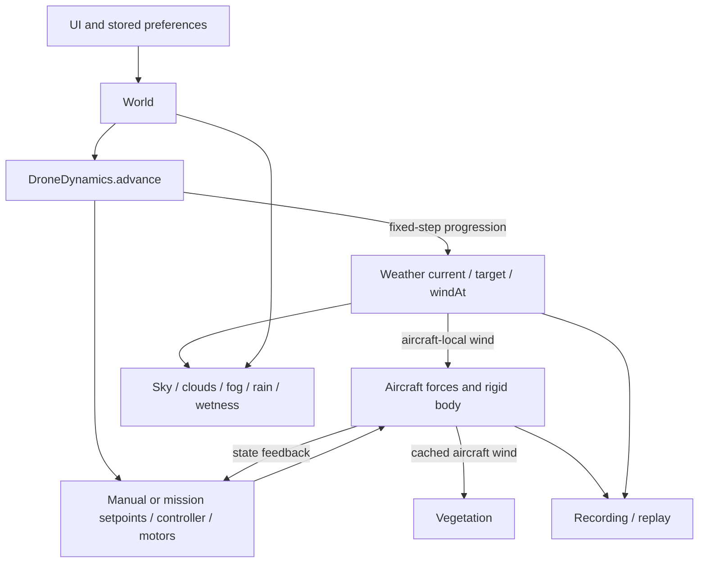

# UAV ARENA simulation master plan

Updated: 2026-11-19, Asia/Ho_Chi_Minh. Baseline: `main`, `aeeeccd617e39b0bff7c9aae717c6c7af0416946`.

## Status and authority

**Phases 1 and 2 were formally accepted. The user approved P3-v1 implementation on 2026-11-19. Phase 3 is incomplete: isolated sky/path and performance failures require the proposed [P3-v2 amendment](PHASE_3_REVISION_PROPOSAL.md) before that architectural change. Phase 4 remains unauthorized.** See the [interim handoff](PHASE_3_INTERIM_HANDOFF.md) and retained [approved P3-v1 baseline](PHASE_3_CONTRACT.md). Human aesthetic acceptance has not occurred.

This file owns the six-phase roadmap and phase implementation contracts. Read it with [DESIGN_STANDARDS](DESIGN_STANDARDS.md), [ARCHITECTURE_DECISIONS](ARCHITECTURE_DECISIONS.md), and [PHASE_HANDOFF](PHASE_HANDOFF.md), in that order, before continuing. The user's latest instructions take precedence. These records govern this simulation-realism program; older reports remain historical evidence, not competing roadmaps.

The user approved P1-v1, then formally accepted the scoped Phase 1 result and authorized Phase 2 planning. The user later approved P2-v1, received its completed handoff, and now states: **"I formally accept Phase 2 (P2-v1) within its documented and validated scope, including all explicitly stated limitations"** and authorizes **"Phase 3 planning and contract preparation only."** The same instruction requires a complete proposed contract for approval and forbids application-code changes. See [current handoff](PHASE_HANDOFF.md), [accepted Phase 2 report](PHASE_2_HANDOFF.md), and [proposed P3-v1](PHASE_3_CONTRACT.md).

## Objective and preserved foundation

Deliver one coherent browser-native UAV simulator: environmental state, flight dynamics, presentation, animation, art direction, and performance must agree. Prefer understandable, evidence-backed improvements to increasing complexity. Physical effects must have justified mechanisms; visual effects must describe the same environment. Do not add decorative aircraft wobble or rain forces.

Preserve the force-based 15 kg demonstrator, wind-relative drag, motor lag/thrust/reaction torque, controller disturbance rejection, fixed-step integration, shared manual/automatic aircraft, deterministic tests, calibrated arena geometry, Vietnamese training workflow, fixed pilot optics, mock restrictions, and immutable historical records. The aircraft remains illustrative and uncalibrated; the program does not establish official examination equivalence, hardware compatibility, or a digital twin.

## Verified baseline architecture (before Phase 1)

Rechecked against baseline commit `aeeeccd617e39b0bff7c9aae717c6c7af0416946` on 2026-11-19. Source ranges in this historical section refer to that commit; links locate the corresponding modules, whose implementations have since changed. The six-phase sequence remains appropriate. The implemented Phase 1 architecture below describes current code.

- Runtime: React 19.3.1, TypeScript, Vite, Three.js 0.187.0; no external rigid-body engine ([package.json](../../package.json)).
- `World` constructs one `Weather` and passes it to `DroneDynamics` ([World.ts](../../src/scene/World.ts), lines 95–110). React changes target parameters through guarded World APIs; READY edits also synchronize current weather and starting metadata (lines 789–851).
- `DroneDynamics.advance()` owns elapsed-time admission, accumulator, weather progression, and aircraft stepping. Fixed step is 0.004 s; each call admits at most 0.1 s. `step()` runs input hooks, mission/controller, motors, body-relative quadratic drag, rigid-body integration, contact, and recording hooks ([DroneDynamics.ts](../../src/simulation/DroneDynamics.ts), lines 315–452; [parameters.ts](../../src/simulation/parameters.ts)). Direct `step()` currently bypasses `Weather.step()`.
- Aircraft wind is sampled at aircraft position and time. The controller responds to ideal aircraft state; manual inputs move stabilization targets, while automatic missions generate targets for the same plant (Dynamics lines 222–313, 326–444; [input.ts](../../src/training/input.ts), lines 178–190).
- Rendering uses analytical Sky, separate layered clouds, scene fog, sun/hemisphere light, a fading ground context, PBR wetness, and rain lines. One ACES/sRGB configuration is in World lines 167–177. Cloud advection accumulates in rendered updates; rain uses instantaneous origin-sampled wind and partial camera translation ([atmosphere.ts](../../src/scene/atmosphere.ts), lines 20–83, 141–209).
- Vegetation is world anchored but receives the aircraft's cached wind everywhere (World lines 1256–1265; [grass.ts](../../src/scene/grass.ts); [grassClumps.ts](../../src/scene/grassClumps.ts)).
- Training input is consumed per fixed step; reference keyboard input is consumed once per render frame (World lines 974–990, 1136–1145).
- Attempts record relative time, weather seed, actual weather, wetness, aircraft wind, and pose at nominal 50 Hz. Replay interpolates pose, restores sampled weather, pauses the live aircraft, and still passes live aircraft time/wind to environmental rendering ([Session.ts](../../src/training/Session.ts), lines 36–109, 149–180, 523–565; [records.ts](../../src/training/records.ts), lines 290–316; World lines 947–970, 1147–1265).

## Implemented Phase 1 architecture (current source)

P1-v1 was approved by the user on 2026-11-19 ("I approve"). The implementation preserves the controller, motor/force kernel, parameters, missions, arena and input meanings. Current evidence/disposition is in [PHASE_HANDOFF](PHASE_HANDOFF.md).

- [Simulation.ts](../../src/simulation/Simulation.ts) owns integer ticks, derived elapsed time, admission/drop accounting, pause, environment progression and completed cloud transport. `DroneDynamics.advance()` and fixed `step()` delegate to it; only its callback runs the aircraft kernel. Explicit non-fixed single steps reject. The existing 0.1 s admission cap remains; a 1e-12 s boundary tolerance prevents floating remainders from losing whole fixed ticks. Resume notifies World to discard its wall-time baseline, without admitting paused time.
- [Weather.ts](../../src/weather/Weather.ts) supplies one snapshot-capable wind evaluator and shortest-arc direction transitions. World consumes both reference and training demand at fixed-step boundaries, preserving their respective world/body coordinate conventions.
- World selects a completed/interpolated live snapshot or a recorded/legacy presentation snapshot. Atmosphere, materials and vegetation read this selection; rendering no longer integrates cloud transport or writes playback values into live Weather. Vegetation uses tile-specific uniform vectors/materials with shared geometry/programs; visible and depth passes share each tile's sample. Cloud/rain retain declared bulk approximations and unchanged visual style.
- New schema-1 attempts/frames carry an optional `environment` object: `version=1`, `model=sinusoidal-bulk-v1`, `seed`, `tick`, `time`, `current`, `target`, `wetness`, `cloudOffset=[x,z]`. Header time is the absolute simulation epoch at attempt creation; frame time remains attempt-relative. Completed records require tick-grid time, finite/bounded data, matching seed/weather/wetness and consistent relative time. Presentation time can lie between completed ticks: continuous fields interpolate, discrete tick/model/seed/target hold the preceding state. Interpolated presentation is not a restorable completed tick.
- Legacy replay reconstructs bulk transport using a relative-time trapezoidal prefix cache (two float64 values per frame); it preserves original records/checksums and labels missing historical phase approximate. Fresh H resets/READY initialize selected weather and equilibrium wetness, continuation preserves history, and replay restores prior live pause status without mutation.

P1 scope does not resolve the horizon, rain optics/placement/repetition, rain-slider solar-time coupling, advanced wind/aero fidelity or hardware performance acceptance. Those remain tracked below. Recording numerical bounds allow up to 1e9 ticks (about 46 days, well above a 600-second attempt) and a conservative 1e9 m transport input bound; they are input-safety limits, not physical tuning constants.

## Source-backed issue register

IDs remain stable across phases. This register preserves baseline diagnoses; ENV-01/02 (within declared bulk/tile approximations), TIME-01/02, REPLAY-01 and RESET-01 have Phase 1 corrections with evidence in PHASE_HANDOFF. Phase 2 clarified AERO-01's existing drag/motor/moment semantics and measured CTRL-01 saturation/recovery; it did not add the deferred higher-fidelity physics or redesign the controller. PERF-01 remains an intentional bounded scheduling policy, now validated. Remaining higher-fidelity capabilities and visual issues stay open. A code-confirmed limitation is not necessarily a defective physical model.

- **ENV-01, confirmed issue, Phase 1:** direction is blended as an ordinary scalar; 359°→1° passes through 180° ([Weather.ts](../../src/weather/Weather.ts), lines 81–84).
- **ENV-02, confirmed issue, Phase 1:** aircraft, origin-sampled atmosphere, and aircraft-sampled vegetation use different spatial contracts (Dynamics lines 405–409; atmosphere line 171; World lines 1256–1265).
- **TIME-01, architectural risk, Phase 1:** aircraft owns environmental scheduling; direct stepping and normal advance have different progression responsibilities (Dynamics lines 315–325, 383–405).
- **TIME-02, confirmed issue, Phase 1:** reference keyboard target integration depends on render batching, unlike training input (World lines 1136–1145, 974–990).
- **REPLAY-01, confirmed issue, Phase 1:** playback weather/pose use replay frames but environmental time/wind use frozen live state; cloud offsets depend on previous render/reset history (World lines 1147–1265; atmosphere lines 123, 171–178).
- **RESET-01, architectural risk, Phase 1:** aircraft reset, weather blending/wetness, cloud offset, and READY initialization have no complete shared reset/snapshot contract (Dynamics lines 80–94; World lines 804–807, 900–970).
- **ATM-01, confirmed architectural inconsistency, Phase 3:** fog, cloud horizon tint/fade, and camera-height-dependent context fading independently control the horizon. Their separate contributions to perceived whiteness still require controlled browser comparisons (atmosphere lines 53–76, 166–170; World lines 377–409).
- **ATM-02, missing defined capability, Phase 3:** `visibility` is mapped to FogExp2 density without a specified contrast threshold; sky/cloud shaders do not share scene fog extinction (atmosphere lines 44–77, 170).
- **LIGHT-01, confirmed limitation, Phase 3:** PMREM refresh keys cloud/time, while rain also changes cloud radiance; lighting components use separate mappings (World lines 1244–1254; atmosphere lines 65–72, 141–169).
- **RAIN-01, confirmed issue, Phase 4:** fixed 0–30 m height, identical streak properties, 1.667 s height cycle, `0.35 * camera.xz` displacement, signed remainder, and instantaneous-wind repositioning (atmosphere lines 101–115, 184–209).
- **RAIN-02, confirmed inconsistency, Phase 4:** quality changes particle count and perceived optical density; default High budget differs from explicit High selection (atmosphere lines 123–136, 186–188).
- **WEATHER-01, confirmed scenario coupling, Phase 3:** the rain slider also changes `timeOfDay`; separate those controls when coordinating atmospheric parameters ([weatherPresets.ts](../../src/training/weatherPresets.ts), lines 46–54). Phase 1 must not silently change this mapping.
- **AERO-01, missing higher-fidelity capability, Phases 2/5:** centre-applied axis-wise drag, fixed density, no wind-dependent aero moment or rotor inflow; parameters are uncalibrated (Dynamics lines 405–444; parameters). Existing wind-force coupling is correct as a simplified model and must be retained.
- **CTRL-01, architectural risk, Phase 2:** bounded integrals and motor clipping are present; allocation-aware anti-windup and derivative filtering are absent. No observed instability is claimed (Dynamics lines 326–380).
- **WIND-01, missing higher-fidelity capability, Phase 5:** sinusoidal gust/turbulence, no Y dependence, no calibrated spectrum or intensity/length-scale contract (Weather lines 89–104).
- **CONTACT-01, model limitation, Phase 5 candidate:** four foot heights select a lowest point but surface is chosen at aircraft centre; fixed dry/wet friction. No new contact model is mandated (Dynamics lines 454–495).
- **PERF-01, confirmed scheduling policy / unverified hardware capacity, Phases 1/6:** 100 ms admission cap deliberately slows simulation under sustained long frames. Preserve protection, measure real-time factor, do not promise real-time 250 Hz (Dynamics lines 315–324; World lines 1303–1319).
- **PERF-02, likely issue requiring profiling, Phase 6:** cloud fragment cost, vegetation/shadows, PMREM refreshes, and physics allocation are candidates. Rain is one draw object; particle count alone does not identify a bottleneck. Hardware measurements are missing.

Earlier one-off audit probes are useful corroboration, not permanent regression fixtures. Their mechanisms are preserved above with source references; Phase 1 must add durable tests for its affected findings.

## Target responsibilities and conventions

- One coordinator owns clock ticks, elapsed-time admission, pause/reset lifecycle, and exactly-once environment/aircraft advancement. `World` supplies inputs and renders; the aircraft consumes environmental samples. See ADR-002.
- Keep one Weather parameter set and one wind formula. Sampling is a function of parameter snapshot, seed/model version, world location, and authoritative time. Approximations declare sample location, height, time, and error/limitations. See ADR-003.
- A presentation snapshot supplies live interpolated or replayed aircraft/environment state through the same renderer-facing contract. Render calls must not integrate authoritative environmental history. See ADR-005.
- Preserve SI units and current coordinate conventions: world Y up, X along the 45 m edge, Z along the 27 m edge; body +Y thrust, +X right, −Z forward; body-to-world quaternion; body angular rates. Wind direction is **towards**, from +X towards +Z, in degrees, normalized modulo 360.
- Physical time, attempt-relative time, solar time, and camera/UI time are different quantities. Name them explicitly. Solar time is an environmental parameter, not simulation elapsed time. Camera movement never changes world wind, particle identity, or physics.
- No new runtime dependencies, general event bus, ECS, separate mode-specific plant, renderer migration, or CFD is planned.

## Six-phase roadmap and dependencies

Phases 1 and 2 are **implemented, scoped validation passed and formally accepted**, each with documented limits. Phase 3 implementation was explicitly authorized under [P3-v1](PHASE_3_CONTRACT.md), but its [interim validation](PHASE_3_INTERIM_HANDOFF.md) is incomplete and includes P3-D/J failures. The [P3-v2 sky/path amendment](PHASE_3_REVISION_PROPOSAL.md) is proposed and awaits approval before dependent implementation. Phases 4–6 are **not started**; Phase 4 additionally requires final human aesthetic acceptance of Phase 3.

### Phase 1 — Unified environment and simulation time

**Current result:** implemented, scoped gates passing, formally accepted on 2026-11-19; see PHASE_HANDOFF. The acceptance includes documented limitations, not final atmospheric quality or real-aircraft calibration. Modules: scheduling, Weather, World, vegetation sampling, recording/replay, focused tests. Outcome: deterministic environmental lifecycle and presentation inputs. No visual redesign or aero model changes.

### Phase 2 — Flight physics and controller validation

Entry: Phase 1 accepted and detailed P2-v1 explicitly approved (both satisfied). The implementation documented drag-area interpretation, force/moment accounting, motor limits, saturation/recovery and numerical convergence. Gains and physical laws remain unchanged. Modules: existing dynamics, bounded diagnostics, tests, assumptions and provenance. Exit: scoped P2-A–J gates pass; see PHASE_2_HANDOFF for observed measurements and limits. **User accepted this scoped result on 2026-11-19.** Advanced turbulence/moments remain Phase 5. The approved contract is retained below as the implementation baseline.

### Phase 3 — Atmospheric visual foundation

Entry: accepted Phases 1 and 2 and explicit P3-v1 approval (both satisfied). Initial in-scope implementation defines 5% MOR extinction, repairs camera-height context alpha, decouples rain editing from solar time and updates reflection invalidation. Isolated captures prove the retained Three sky and local path radiance fail to converge at the horizon; the first SwiftShader profile also fails P3-J. The proposed [P3-v2 amendment](PHASE_3_REVISION_PROPOSAL.md) narrowly permits a shared sky/path radiance replacement inside the existing renderer if approved. P3-A–L and expert art review remain mandatory; no Phase 3 visual acceptance is claimed.

### Phase 4 — Rain realism and weather presentation

Entry: accepted Phase 3 visual foundation and existing Phase 1 contracts; separate authorization. Resolve RAIN-01/02 through stable spatial placement, continuous wind-consistent trajectories, exposure-aware varied streaks, distant precipitation, weather transitions, camera altitude coverage, and quality-invariant perceived intensity. Modules: rain/atmosphere, quality controls, recording extension only if required. Exit: observed motion and comparable frames meet rain standards; no camera dragging, visible cyclic reset, or weather-change teleportation; optics and cost measured. Technique selected from evidence, not mandated now. Risks: overdraw, recycling seams, excess brightness; more particles is not an acceptance measure.

**Required Phase 3 inheritance handoff before Phase 4 planning:** accepted linear-light sky/path radiance function and units; 5% MOR extinction and depth/occlusion convention; current EnvironmentSnapshot/seed/selected-time rule; sun/cloud/ambient and reflection update policy; fixed exposure/color-management path; near/mid/far test sample proving that rain attenuation is applied once; measured camera/weather/motion board and remaining artifacts. Phase 4 may not compensate for an unaccepted horizon with streak opacity, fog, grading or a second atmosphere. This handoff is currently **not available** because P3-C/D/I/J remain incomplete or failed.

### Phase 5 — Advanced environmental and aerodynamic fidelity

Entry: accepted Phases 2 and 4, documented aircraft fidelity target/data and approved contract. Evaluate justified gust statistics, spatial/altitude wind, aero moments and inflow, and optional surface interactions. Modules depend on evidence. Exit: assumptions/coefficients stated, held-out data or explicitly limited analytical validation, reproducible disturbances, stable controller response and no double-counted forces. Risks: unsuitable hover turbulence assumptions and invented calibration. Prefer bounded local evaluation; defer unsupported physics instead of adding dramatic motion.

### Phase 6 — Performance, refinement and final quality

Entry: prior five phases accepted; explicit reference devices, workloads, budgets, and final contract approved. Profile CPU/GPU, clouds/rain/vegetation/shadows/reflections, memory, real-time factor, cross-camera animation, and long-run regressions. Exit: measured target budgets, cumulative technical/visual/motion acceptance, actionable final handoff. Risks: optimizing unmeasured bottlenecks or sacrificing physical equivalence. Hardware gaps remain unverified, never converted to passes by SwiftShader results. Earlier quality gates cannot be postponed here.

## Phase 1 implementation contract — approved P1-v1

Historical approved contract, retained for invariants. Its implementation was validated and its result formally accepted on 2026-11-19; the original exit-review requirement below has been satisfied.

Contract ID: **P1-v1**. Related findings: ENV-01/02, TIME-01/02, REPLAY-01, RESET-01, PERF-01. Supporting decisions: ADR-002 through ADR-006. Approval applies to the behaviours below, including fresh-run wetness initialization and legacy replay limitations.

### Intended outcome and architecture

Extract one small fixed-step coordinator from the existing scheduler. It owns tick index/time, accumulator, admitted/dropped time, and environmental advancement; Weather remains the parameter/field implementation and DroneDynamics remains the sole aircraft plant. The coordinator can be a focused new module under `src/simulation/`; final naming is an implementation detail. Existing `advance`/single-step entry points used by tests and browser tooling must delegate to the same authoritative stepping path, not retain a second loop. Explicit thrust-override fixtures remain possible.

Use an integer tick as the authoritative elapsed-time origin and derive seconds with the existing 0.004 s step. Retain the 0.1 s per-advance admission cap and no hidden-tab catch-up. Invalid/non-finite/negative elapsed inputs must never poison state or run backward; test their defined rejection/no-advance behaviour. Keep the current ideal-state controller, motor constants, force/contact equations, and mission setpoints unchanged.

Per tick, in order:

1. Consume pending authorized weather changes and the held input snapshot at a defined tick boundary.
2. Advance weather and wetness exactly once through the existing scalar blend/time constants, with shortest-arc direction handling. Use the resulting time `t[n+1]` for this tick's wind sample, preserving the normal advance path's current convention.
3. Apply manual target/yaw integration once with fixed dt, or update automatic mission setpoints; then run controller, motors, forces, rigid body, and contact in their existing order.
4. Advance deterministic environment transport/presentation state once, using a documented sample/quadrature rule and the same field/time. Cloud transport must no longer accumulate in rendered updates.
5. Record the completed aircraft/environment tick and publish previous/current presentation endpoints. Hooks remain exactly-once and retain before-input/after-physics meaning.

Direct `step()` currently skips weather progression. Its supported public replacement must use the authoritative single-tick path; document this intentional semantic correction and cover it explicitly. An internal numerical kernel may receive explicit environment/time without scheduling itself, but is not a competing production loop. Legacy writable time fields, if retained temporarily for tooling, may not become a second clock; update callers or use a validated reset/restore operation.

### Wind sampling and visual boundary

Expose one CPU wind evaluator usable with explicit snapshot parameters/seed/time and output storage; keep `Weather.windAt()` as a delegating convenience if useful. Preserve the existing gust/turbulence formula and units. No altitude gradient, spectral turbulence, aero moments, or controller feed-forward is added.

- Aircraft samples at its actual physical position, never camera/interpolated pose.
- Vegetation samples at stable world tile centres (near 2 m, middle 4 m), using the shared evaluator; GPU receives these samples without inventing another wind equation. Retain seeded instance positions, bending response, and matched visible/depth deformation. Tile approximation bounds follow the current sine field's gradients; derive and test them rather than choosing an unexplained tolerance.
- Existing rain receives a documented bulk sample at its actual current rain-volume centre, not implicitly at the origin. This is an interim spatial approximation, not a claim of per-drop wind consistency. Do not replace placement or trajectories in this phase.
- Existing cloud advection remains a large-scale bulk approximation at declared world reference points/heights. Retain the current 0.3 transport scale as a documented legacy visual approximation, not a physical wind speed. Store its model/version and transport state. Revisit its scale/height behaviour with Phase 3/5 evidence, not by tuning now.

Correct only timing and sampling adapters in shaders/presentation. Preserve current sky colors, fog/visibility mapping, lighting/exposure, terrain, cloud shape, rain primitive/count/opacity/height, LOD and camera optics. Existing rain jumps under changing wind, repeat cycle and camera attachment remain explicitly open RAIN-01; Phase 1 acceptance must not claim those are fixed. No new discontinuities in the corrected paths are acceptable.

### Temporal and lifecycle rules

- **Direction:** normalize modulo 360; blend the shortest signed angular difference. Define the exact 180° tie as positive rotation so tests are deterministic. Equivalent 0°/360° endpoints must not spin the field. Keep the existing 2 s scalar time constant; do not apply UI easing to aircraft/environment dynamics.
- **Ordinary pause:** freeze tick, weather/wetness evolution, cloud transport, and other simulation-time phases. Target edits may be pending while paused; elapsed wall time is not replayed on resume. Camera/head-look/UI may remain responsive without modifying environment state.
- **READY edits:** synchronize selected current/target parameters without advancing clock. Capture the same initial environment shown in preview and later used by the attempt; do not retain stale aircraft wind.
- **Fresh run / explicit H reset:** permitted only under existing reset guards. Preserve selected weather target, seed, mission choice, controller/hooks, and training restrictions; set tick/accumulator/dropped time and cloud transport to their documented initial values. Initialize current=target and wetness=current rain, the equilibrium of the *existing* wetness model. This explicitly replaces history-dependent initial wetness; it is not a claim of real hydrology. Dry starts are dry; rainy scenario starts use that model's wet equilibrium. No additional UI is introduced.
- **Continuation/resume:** preserve current/target weather, wetness, transport, clock and aircraft; never invoke fresh-run initialization. Opening conditions preserves session identity/progress and existing mock locks. Started changes update target and append events without rewriting initial metadata.
- **Replay entry/exit:** freeze and preserve the complete live environment/clock/pause context. Render a separate playback snapshot through the same presentation API; do not write recorded values into live authoritative Weather on every render. Exiting restores the previous live context and pause status exactly, without a new tick or replay elapsed time leaking into live state.
- **Seek/speed/camera/quality:** choosing a replay timestamp determines environmental presentation independently of seek order and wall duration. Playback speed scales traversal of recorded time, not simulated gust frequency at a fixed timestamp. Camera or quality changes do not mutate authoritative state. No accumulating playback cloud offsets in the renderer.

### Recording and compatibility

Keep sealed original payloads/checksums immutable. Extend new schema-1 attempts with a strictly validated, explicitly versioned optional environment block rather than rewriting old recordings or silently changing the meaning of their existing fields. Capture initial environment epoch/model version/seed/current/target/wetness/transport, and sufficient tick/time/transport state at recorded frames for deterministic environmental seeking. Existing `weather`, `wetness`, `wind`, relative time and aircraft fields remain available with their current meanings. Bounded adjacent-frame interpolation uses recorded completed states; discrete fields use a documented hold rule, angles use shortest arc. Replay remains recorded-state playback, not flight resimulation.

For legacy records without the extension, use only logged weather, wetness, seed, and relative time with a declared zero phase origin and deterministic derived transport history. Original absolute wind phase and cloud history cannot be recovered: label the adapter as approximate legacy environmental reconstruction, not exact historical playback. A prefix transport cache built once per loaded record is acceptable within existing recording limits; seeking must not integrate from the last viewed timestamp. Do not mutate, reseal, or persist adapted legacy payloads. Validate extension versions, finite values, tick/time ordering, bounds, and interpolation inputs; reject malformed supplied extensions rather than falling back as if absent.

This extension stores transport state needed by Phase 1, not future per-drop rain or rotor data. New wind/rain models require their own later versioned decisions.

### Affected modules and preserved functionality

Expected edits after approval: `src/weather/Weather.ts`; `src/simulation/DroneDynamics.ts` and one focused coordinator module; `src/scene/World.ts`, `atmosphere.ts`, `grass.ts`, `grassClumps.ts`; `src/training/Session.ts`, `records.ts`; relevant tests and browser diagnostics; the four governance records. Minimal caller updates in `src/ui/App.tsx`/review UI or existing scripts are allowed only for lifecycle/legacy-status compatibility. Explain each such change. No UI redesign, scoring/profile change, asset replacement, dependency change, or aircraft parameter retuning.

Preserve manual body-frame velocity/climb/yaw semantics, reference keyboard world-frame mapping, automatic routes and completion rules, reset guards, focus/gamepad interruption, manual-only restrictions, mock weather locks, practice/demo preference isolation, pilot station/FOV/unit aircraft scale, ground guide policy, immutable annotations/exports/imports, and existing record limits. Moving reference demand integration to fixed steps intentionally removes frame-batching differences; it does not change its coordinate frame or input magnitudes.

### Risks and performance constraints

- A second clock, weather tick, or input integration would alter forces and mission speed: assert tick accounting and characterize normal advance before extraction.
- Reset/wetness changes and new clock ownership can disturb READY snapshots or attempt-relative timestamps: test full navigation and attempt lifecycles.
- Local vegetation sampling adds CPU work: sample per tile, reuse storage, avoid per-blade CPU work, and measure the cost. The unchanged cloud transport approximation is intentionally bounded work.
- Record extensions and caches add bounded memory/storage: report bytes per recorded second and seeking/cache behaviour at the existing maximum duration; no unbounded history.
- Existing browser scripts rely on public dynamics methods and use software rendering. Preserve or deliberately migrate their invocation paths; do not confuse synthetic fast stepping with measured real-time performance.
- No invented FPS budget. Record comparable baseline/post-change CPU frame percentiles, draw calls, memory, steps/wall second and real-time factor under stated workloads. GPU timings are reported only when actually available. A measured regression requires explanation and review, not a silent threshold change.

### Planned validation and acceptance

Targets below are **proposed software acceptance criteria** for P1-v1, not observed results or real-aircraft tolerances. Use the same runtime/build for determinism comparisons; cross-device GPU byte identity is not promised.

- **P1-A, architecture:** one coordinator/advancement path; exactly one environment update, command integration and aircraft update per completed tick; rendering and replay inspection cause zero authoritative ticks. Source review and instrumented tests demonstrate this.
- **P1-B, numerical/physics preservation:** all 39 baseline checks and added tests pass; unchanged coefficients/gains/contact/motor equations; analytical initial drag remains 12.544 N for stationary level aircraft with 8 m/s +X wind and current parameters. Zero-wind and existing seeded normal-advance runs agree with characterization within 1e-8 m position and 1e-8 quaternion geodesic radians over the selected short fixtures. Compare equal admitted ticks; intentional corrected paths are tested against their new contract, not forced to reproduce their defects.
- **P1-C, time/commands:** timestamped tick-input fixtures under 30/60/120 Hz and irregular sub-100 ms render schedules produce the same tick count and aircraft/environment outputs within 1e-8 in their SI units. Include reference and training command adapters, nonzero wind, and weather changes. Compare quaternions geometrically. Raw DOM polling latency is outside this numerical guarantee. Overload tests separately verify the 0.1 s cap/dropped-time accounting; hidden-tab and paused time never catch up.
- **P1-D, direction:** 359°→1° and reverse follow the short arc; 0°/360° equivalence and ±180° tie are deterministic and continuous in sampled wind. No unintended reversal.
- **P1-E, wind:** point samples agree with the shared evaluator within 1e-9 m/s on CPU; tile approximation respects analytical gradient bounds. Moving the aircraft or camera alone cannot change wind at a fixed vegetation tile/time. Log bulk cloud/rain reference points; no claim of resolved per-drop trajectories.
- **P1-F, lifecycle:** pause/resume does not change snapshots without admitted ticks; fresh reset twice reproduces the same initial aircraft/environment, including wetness and transport; READY preview=recorded initial state. Reject active-session resets; preserve mock/final/replay setter locks and input-loss behaviour.
- **P1-G, replay/records:** new captures at a timestamp match their logged environmental states within 1e-8 for continuous CPU values; forward/backward/repeated/random seeks and 0.5×/1×/2× traversal agree. Enter/exit preserves live snapshots/pause state exactly. Legacy JSON, checksum, annotations and exports remain unchanged; malformed/unsupported extension fixtures reject. Legacy presentation is deterministic but explicitly approximate.
- **P1-H, visual/motion regression:** observe real browser sequences using the scene set in DESIGN_STANDARDS. Confirm corrected cloud/vegetation time freezes/resumes, seek independence, stable world anchors, camera changes with no authoritative mutation, unchanged pilot optics, and no new exposure/terrain/rain-style changes. Retained RAIN-01/ATM-01 defects are listed, not called fixed. If browser observation is unavailable, this required gate remains UNVERIFIED and Phase 1 cannot be declared complete.
- **P1-I, integration/performance:** headless tests, typecheck and production build; current browser/conditions/zoom regressions where affected; same-build representative static and moving sequences; baseline/post cost and record-size results. Software-renderer measurements can validate execution and comparative cost, not hardware targets. Hardware capacity remains explicitly UNVERIFIED if no real device is measured.

Before changes, capture deterministic characterization fixtures and comparable browser scenes for touched paths. Existing scripts write evidence and some target historical selectors; inspect before use, adapt only as required, archive comparisons under a phase-specific evidence directory rather than overwrite historical captures. Do not install dependencies without a demonstrated need. The phase handoff must distinguish new test evidence, historical evidence, and unobserved gates.

### Phase 1 exclusions and approval boundary

Excluded: horizon/fog/color/exposure redesign, rain replacement/optical calibration, rain-slider solar-time decoupling, new cloud geometry/volumetrics, turbulence/altitude models, new aero forces/moments/inflow, controller retuning, wet-friction changes, sensor models, rotor geometry or exact historical rotor phase reconstruction, workers, renderer migrations, and broad optimization. Timing/sampling corrections are required; aesthetic upgrades are not.

After P1 validation: record each acceptance result, remaining issue IDs, evidence paths, ADR status, exact files changed and performance limits in PHASE_HANDOFF; update this roadmap and stop. A failed or unobserved required gate means implemented/incomplete or awaiting validation, never complete. Ask for user review; do not start Phase 2 automatically.

## Phase 2 implementation contract — approved P2-v1, scoped gates validated

### Authority, outcome and fidelity boundary

Contract ID: **P2-v1**, prepared and explicitly approved 2026-11-19. Findings: **AERO-01, CTRL-01, PERF-01**, with Phase 1 TIME/ENV/RESET/REPLAY invariants as dependencies. Decisions: implemented ADR-002–006 and ADR-008–010. This section retains the approved design and acceptance targets; actual implementation, measurements, failures/retries and disposition are in [PHASE_2_HANDOFF](PHASE_2_HANDOFF.md). The original planning-state record remains immutable historical evidence.

Deliver a physically explained, analytically checked and quantitatively characterized version of the **existing illustrative 15 kg plant**, with bounded inspection of force, moment, actuator and controller behavior. There is no evidence supporting a replacement physics engine or new coefficients. Therefore P2-v1 authorizes, after approval, diagnostics, meaningful tests, parameter/assumption documentation, a narrowly defined invalid-override guard, and only behavior-preserving extraction needed by those checks. It does **not** authorize new aerodynamic terms, gain tuning, altered integration or saturation policies. A required gate failure is evidence for a P2-v2 proposal, not permission to tune until a screenshot looks plausible.

Separate three conclusions throughout the evidence: (1) equation/unit/frame correctness; (2) numerical and closed-loop behavior under specified synthetic conditions; (3) agreement with real aircraft. This phase targets the first two. The third remains **UNVERIFIED** without aircraft identity/configuration, mass/CG/inertia, motor/thrust data, instrumented flight logs, measured wind and sensor/controller timing, uncertainty and held-out validation. Tests agreeing with these equations do not calibrate the UAV. Follow [REAL_WORLD_VALIDATION_PLAN](../REAL_WORLD_VALIDATION_PLAN.md) for that separate program.

### Entry state and immutable foundation

Planning inspection found `main` at `aeeeccd617e39b0bff7c9aae717c6c7af0416946`, with the 25 pre-existing tracked/untracked status entries from Phase 1 preserved. The Phase 1 manifest's 19 source hashes match; its final bundle remains `index-I7FYVFLg.js`. The accepted evidence records 46 tests, typecheck/build, 16 browser regression groups and six motion/replay groups. Those are **prior observed results**, not new Phase 2 runs. The planning-state manifest linked in PHASE_HANDOFF records the current source identity. Recheck it before approved implementation; reconcile intervening user edits without discarding them. No checkout, reset, commit, dependency install or publication is part of this contract.

Preserve one `Simulation` clock (250 Hz, 100 ms admission cap), one `Weather` field/version, one `DroneDynamics` plant for reference/manual/automatic modes, and read-only snapshot presentation. Preserve tick order, completed hooks, fixed-boundary command integration, reset/READY wetness, pause/resume baseline invalidation, local wind sampling, recording time meanings, replay independence and immutable sealed legacy payloads. Preserve arena/missions, task profiles/scoring, manual-only restrictions, input mappings/neutral-start/interruption policies, Mock locks, pilot optics, cameras, geometry/assets, quality/LOD and the complete DESIGN_STANDARDS. Phase 1's historical characterization fixtures remain immutable tests of the accepted foundation.

### Repository model ledger and accounting contract

Owning source: [parameters.ts](../../src/simulation/parameters.ts), [DroneDynamics.ts](../../src/simulation/DroneDynamics.ts), [Simulation.ts](../../src/simulation/Simulation.ts), [Weather.ts](../../src/weather/Weather.ts). Keep current parameter keys/values to preserve saved `aircraft` snapshots; clarify semantics in comments/docs rather than mass-renaming a record field.

- **Frames/units:** world Y up; body +Y thrust, +X right, −Z forward; `q` rotates body to world, body rates `omega`; meters, seconds, kg, N, N·m, rad/s. Wind is a world velocity towards +X→+Z, not meteorological wind-from. `arm=0.48 m` is each X/Z offset, not radial motor distance (which is about 0.679 m). Motor positions are `[x,z]`, not `[x,y]`.
- **Mass/inertia/gravity:** 15 kg, diagonal body inertia `(0.65,1.05,0.65) kg·m²`, gravity 9.80665 m/s², weight **147.09975 N**. CG is the body origin; no measured offset or mass/payload variation exists.
- **Air-relative drag:** `u_b = R(q)^T (v_world − wind_world)`, `D_b[i] = −0.5*rho*dragArea[i]*u_b[i]*abs(u_b[i])`, `D_world=R(q)D_b`. The stored `(0.32,0.55,0.32) m²` values are **effective Cd·A products**, since no separate Cd appears; they are not measured projected geometry. Density is fixed 1.225 kg/m³. Axis-wise drag can be nonparallel to flow; it is a simplified anisotropic model, not a full coefficient polar. Its air-relative work must be nonpositive. Ground-relative kinetic energy need not decrease in moving wind.
- **Forces:** `F_world = R(q)*(0,sum(f_i),0) + D_world + (0,−mg,0)`. Drag acts at CG and gives no direct aerodynamic moment. Wetness/rain/cloud/visibility/solar time add no aircraft force. Wind acts once through air-relative velocity; there is no independent gust impulse or wind-angle animation.
- **Motors:** desired magnitude `Omega_d=sqrt(clamp(f_command,0,f_max)/kT)`; `Omega_next=Omega_d+(Omega_old−Omega_d)*exp(−h/0.045)`; actual `f_i=kT*Omega_next²`. `kT=0.00019 N/(rad/s)²`, `Omega_max=760 rad/s`, **f_max=109.744 N/motor**, total **438.976 N**, theoretical static thrust/weight **2.9842**. Hover magnitude **439.9458 rad/s ≈4201.17 RPM**, 33.51% of maximum thrust, not 33.51% rotor speed. This is a mathematical static envelope, not measured payload/climb/endurance capability. There is no voltage, battery, propeller map or inflow model. Disarm requests zero and preserves spin-down lag.
- **Moments/mixer:** with spin signs `(1,−1,1,−1)`, `tau_x=−sum(z_i*f_i)`, `tau_y=−0.025*sum(spin_i*f_i)`, `tau_z=sum(x_i*f_i)`. Reaction ratio 0.025 has units m. Wrench order is `(T,tau_x,tau_y,tau_z)`. Reconstruct it from both clipped motor commands and actual lagged thrusts. The body rate equation is `I*omega_dot=tau_rotors−omega×(I*omega)−0.12*omega`; the existing 0.12 term is an uncalibrated isotropic rotational damping coefficient (N·m·s), not a measured wind-dependent moment. Keep it and count it once.
- **Integrator/contact:** velocity then position is semi-implicit Euler; body rate is updated before the normalized incremental body quaternion is right-multiplied. Contact follows integration. Existing lowest-foot correction, center-selected surface, restitution/friction, crash/disarm and finite-field safety are preserved. Contact impulses/correction are reported separately from continuous forces; `force` is a pre-contact net force, and current public `torque` is a controller request, not achieved body torque. Do not silently change those existing field meanings.

The drag interpretation follows the coefficient-times-reference-area form in [NASA's drag equation](https://www1.grc.nasa.gov/beginners-guide-to-aeronautics/drag-equation/). The current thrust/moment plant is a deliberately simple rigid-body quadrotor, consistent in scope with the [MIT quadrotor model discussion](https://underactuated.mit.edu/acrobot.html). These references justify model structure, not this aircraft's coefficient values or calibration.

### Work packages and allowed changes after approval

**P2-W1 — Baseline and model specification.** Save immutable before traces and source/build manifests under `docs/simulation/evidence/phase-2/`; do not overwrite Phase 1. Document every parameter, gain, clamp, integrator bound, force/moment frame and sample time. Characterize the unchanged implementation before editing it. Freeze all physical values and reference fixture definitions. Missing or failing evidence must be reported before any behavior-changing remedy.

**P2-W2 — Noninvasive diagnostics.** Add at most one optional, reusable last-completed-step diagnostic structure in the existing dynamics path, default disabled. Capture values where they are computed, not by invoking controller/integrator again: sample time/position/wind; body-relative air velocity; body/world drag; thrust/gravity/net force; demanded, clipped-command and actual rotor wrench; rotor/gyro/damping/net rate moments; raw/clipped acceleration/rate/torque/rotor commands; integrals and saturation flags; pre/post-contact state/correction. Distinguish N from N·m, request from achievement, and previous from resulting state. A test/script collector may stream rows; no learner panel, second telemetry clock, production history buffer, per-tick JSON or new record channel. Disabled/enabled runs must produce identical physics outputs. Extract small arithmetic helpers only if needed to share the **actual** production calculations; remove their old inline counterpart. No separate production or diagnostic plant, generic framework, event bus or dependency.

**P2-W3 — Motor-command boundary safety.** The existing `Simulation.step(thrust?)` path currently indexes overrides without validating shape/finite values. Add one common guard there **before weather, tick, hooks or aircraft mutation**: an override must be an array of exactly four finite numbers. Invalid inputs throw and leave the complete state unchanged, including when called via `DroneDynamics.step`. Preserve existing clamping of finite negative/over-limit values and all valid override behavior. Keep non-fixed public stepping rejected. This is a narrowly authorized API validation correction, not a force-law or scheduling change.

**P2-W4 — Analytical and numerical verification.** Add independent small equation-based oracles in focused Node tests for the ledger above. Use production output for the observed side. Do not copy an entire simulator as the oracle. Timestep studies call the **same existing private aircraft kernel** from a clearly test-only harness at h=0.004/0.002/0.001 s, with constant explicit weather and no active mission, recording, input hook or environment transport. The harness's local numerical time is not a second product clock and cannot restore those intermediate states into `Simulation`. Normal production still runs only h=0.004. If access needs a behavior-preserving extraction, retain a single kernel and prove equality first. No variable-step product API or alternate integrator.

**P2-W5 — Controller/disturbance envelope.** Review the current ideal-state cascade: position/velocity plus bounded integral → acceleration clamps → desired attitude → quaternion rate target (±3 rad/s per component) → rate PID with derivative on measured rates → ±6 N·m torque request → per-motor clipping/lag. Document current gains `(1.7,3.5,1.7)`, `(2.6,3.1,2.6)`, integral gains `(0.3,0.75,0.3)`, position-integral bounds ±3; rate gains 13/3/0.08 with inertia scaling, integral bounds ±0.6; acceleration clamps ±4.5 X/Z and −4/+5 Y; tilt compensation floor 0.45. These clamps are limited protection, **not allocation-aware anti-windup**. Derivative filtering, sensor estimation and actuator-priority allocation are absent; absence alone is not a bug.

Measure saturation duration and recovery without hiding infeasibility. At level hover, the mixer has at most `0.025*147.09975 ≈3.67749 N·m` yaw authority at that collective, before motor lag, less than the 6 N·m request clamp. Report this analytical limitation; do not raise thrust, lower gains, add feed-forward or invent aerodynamic damping to conceal it. [PX4's controller documentation](https://docs.px4.io/main/en/flight_stack/controller_diagrams) illustrates explicit saturation/anti-windup design; it does not make this repository PX4 or justify copying its gains. P2-v1 does not add filtering, conditional integration, back-calculation, new allocation, a rate/raw-throttle flight mode or controller tuning. If response gates fail, propose a specific evidenced P2-v2 remedy and its provenance/compatibility consequences for approval.

**P2-W6 — Same-plant integration, provenance and handoff.** Reuse existing manual/reference command adapters, both automatic missions, session sampling and replay. No model resimulation from saved frames. New evidence must record plant/controller source SHA-256, all coefficients/gains, software/build, seed, weather current/target, authoritative initial epoch, initial complete aircraft/controller/motor state, commands/events/ticks and instrumentation state. Current attempt `controller` metadata describes the **input device**, not PID design; `softwareVersion="uav-arena-0.3.0"` alone does not identify gains. P2-v1 changes no gains/laws, so keep schema and recorded channel meanings unchanged and put diagnostic provenance in evidence sidecars. Any later behavioral model revision requires approved explicit model/controller provenance and old-record compatibility tests before release. Do not relabel old attempts with a new model.

Expected implementation files: `DroneDynamics.ts` (optional diagnostics/minimal extraction), `Simulation.ts` (override guard only), `parameters.ts` (semantic comments only), one focused physics test file plus existing tests where meaningful, one bounded evidence/benchmark script if existing tools cannot collect the required data, and the governance/assumption/controller documentation. `Weather.ts`, input mappings, mission definitions, profiles/scoring, production Session/records/UI, renderer/assets/configuration/package manifests remain unchanged under P2-v1. Tests may exercise those modules. A newly necessary production edit outside this list requires a documented contract revision before it is made.

### Deterministic fixtures and measurements

Use seed 42, t=0, dry surface, solar time 15.5, fixed quality/viewport and explicit wind direction unless stated; record every other parameter rather than rely on preferences. Model checks use an airborne body at `(0,10,0)`, identity q, zero initial velocities unless stated, no contact and no field exit. Closed-loop cases start from an actual calm takeoff at H; after 22 simulated seconds capture the resulting state, then define commands **relative to that captured state**. Do not teleport a moving aircraft to make a flight pass. Synthetic positioned fixtures remain labeled analytical tests. For steady F1/F2 cloned-state cases initialize current=target to the stated weather at the case start and log that initialization; F3 alone tests the actual weather transition. Live browser weather changes use the guarded World API and normal blend, never this test-only initialization shortcut.

- **F0 calm:** wind/gust/turbulence=0. Steady hover/motor baseline and 30 s closed-loop hold after settling.
- **F1 steady wind:** 8 m/s with gust/turbulence=0 at towards 0°,90°,180°,270°. Open-loop force checks plus closed-loop hold, 30 simulated seconds each.
- **F2 reproducible disturbance:** wind=9, gust=4, turbulence=0.7, towards80°, seeds 42 and 17. A 60-second hold and a 30-second manual case (body-forward 1 m/s for 3 s, then release/hold for 27 s); report sampled local wind history, not nominal wind alone. These sinusoids are not a validated atmospheric spectrum.
- **F3 changing wind:** after calm settling, target wind 8/direction0 with zero gust/turbulence for 20 s, then calm 20 s; separately wind 8 at359°→1° and90°→270°. Use the actual 2 s Weather blend; an instantaneous force step is only an explicitly separate analytical fixture. Measure errors against the held target in simulation time.
- **F4 commands:** independently +5 m world X, +2 m altitude, +0.5 rad yaw target steps, each for 15 s from its own settled calm clone; manual body-forward1 m/s for 3 s then release/hold15 s; repeat headings 0 and π/2. Do not demand direct motor power from the centered climb channel. Capture actual traveled pose and generated targets.
- **F5 saturation/recovery:** from settled calm hold, request yaw=current+π for 2 s, then call existing `hold()` and set yaw to the actual current heading with zero target velocity for 20 s. No state/integral/motor reset at release. Require measured rotor clipping during the pulse; otherwise the saturation fixture is invalid, not a pass. Separately test collective/differential finite over/under-limit overrides on short airborne runs. Wind30/gust20/turbulence5 is an **input-bound stress case**, not a claimed hold envelope: require finite bounded actuators/valid disarm or crash transitions, never recovery or official operability at those values.
- **F6 long run/integration:** 600 s calm and F2 hold, both existing calm automatic missions and existing manual training lifecycle; replay new and legacy recordings with pause/reset/READY/seek invariants. Keep safety shutdowns and terminal states visible in results.

Metrics: position/altitude/heading error, RMS and peak, first time entering and remaining in tolerance for the final 2 s, overshoot, speed/body-rate/tilt maxima, requested/clipped/actual wrench residuals, motor bounds/saturation fraction and longest continuous clipping, integral extrema, quaternion norm, contact correction/events, tick count/admitted/dropped time. Measure startup/transition/final windows separately. Use quaternion geodesic `2*atan2(norm(q_error.xyz),abs(q_error.w))`, wrapped heading errors and SI units; do not compare quaternion components or raw Euler wrapping as attitude distance.

### Measurable acceptance gates (approved P2-v1 targets; actual results in handoff)

All thresholds below are **software engineering targets for this model**, not flight-test tolerances, safety limits or calibrated training validity. A required FAIL/UNVERIFIED leaves Phase 2 incomplete. Do not relax a target after observing a failure without a proposed revision and user approval.

- **P2-A — Preservation/architecture:** all 46 accepted tests retained/pass, including immutable Phase 1 30-second characterization within 1e-8 SI units/geodesic rad; one clock/field/kernel, equal-tick schedule independence, reset/READY/pause/replay/Mock/input guards. No coefficient/gain/force-law/integrator/contact/input/mission/scoring/optics change. Diagnostic on/off results identical in the same runtime. Source-diff review must agree with the allowed-file scope.
- **P2-B — Force/frame tests:** independent net-force and moment closure error ≤1e-9 N/N·m absolute plus1e-10 relative to each reference magnitude, for identity and fixed 90°/mixed orientations. Include zero airspeed, stationary aircraft in wind, equal aircraft/wind velocity, axis sign reversals and two-speed quadratic scaling. Stationary level +X wind 8 remains **12.544 N +X drag**; adding the same constant velocity to aircraft and wind leaves drag unchanged. `D_b·u_b ≤1e-10 W` (roundoff allowance). No aero torque from CG drag; no rain-only force change with otherwise identical environment/aircraft state.
- **P2-C — Motor/mixer tests:** constant-command Omega matches the exponential solution at 1τ/3τ/5τ within 1e-9 rad/s; thrust is squared Omega, not a first-order thrust approximation. Symmetric initialized hover has net force/rate within 1e-8 for 4 s. Check each single rotor's torque sign and magnitude, differential yaw, unsaturated forward/inverse wrench closure to P2-B tolerance, saturated achievable wrench and spin-down. Every valid run keeps0≤Omega≤760 and0≤f≤109.744 within 1e-9; invalid override shape/NaN/Infinity rejects before any state change, finite negative/high values retain clamping.
- **P2-D — Rigid-body/numerics:** first contact-free zero-speed/zero-thrust step matches gravity and semi-implicit displacement within 1e-10 m/s and m; subsequent falling includes vertical drag and is not called vacuum free fall. For horizontal drag with initialized hover motors and initial air-relative speed5 m/s, compare 2 s against `u(t)=u0/(1+rho*CdA*abs(u0)*t/(2m))` and its integrated displacement: h=.004 error≤.005 m/s and .01 m. Check one-step `omega×Iomega` and damping signs analytically. For axial initial rate0.5 rad/s, symmetric initialized hover, compare 2 s angular-rate decay to `omega0*exp(−0.12*t/I_axis)` and integrated attitude; compare rotation separately from the resulting translation. Across h/.5h/.25h, nonzero endpoint errors must decrease with successive coarse/fine ratios≥1.5 and≤2.6 for velocity/position and geodesic attitude in these smooth first-order fixtures. For errors below 1e-9, use the absolute floor rather than divide noise. No exact energy-conservation claim with damping/contact/motors.
- **P2-E — Nominal closed-loop response:** F0 final 2 s position error≤.15 m, speed≤.15 m/s, no crash/contact. F4 final 2 s independent X/altitude errors≤.15 m, wrapped yaw error≤.5°, yaw rate≤.03 rad/s; position-step overshoot≤20% of commanded distance, yaw overshoot≤10°; final position and speed criteria must be reached by 15 s. Manual release settles within.20 m of its held target and speed≤.20 m/s by 15 s, both headings. Report rise/settling/overshoot and motor use, not only final samples.
- **P2-F — Wind response:** each steady F1 hold final 5 s horizontal position error≤1.2 m, altitude error≤.30 m, speed≤.30 m/s; F2 60-second hold peak horizontal error≤2.0 m and altitude error≤.75 m with no crash/field exit, and finite measured responses for the manual case. F3 final 5 s of each20-second leg meets F1 limits in wind, then calm error≤.20 m and speed≤.20 m/s after removal. Repeat fixtures with equal tick schedules to1e-8. Do not infer stronger winds, a calibrated gust spectrum or real-world recovery guarantees.
- **P2-G — Saturation/recovery:** F5 proves nonzero commanded-motor clipping and reports the wrench deficit; both integral vectors remain within existing±3/±.6 bounds. During pulse and recovery, no NaN, invalid q, contact/crash or safety exit. By20 s after release, position error≤.30 m, speed≤.20 m/s, wrapped heading error≤2°, body-rate norm≤.10 rad/s; final 2 s has no continuous rotor clipping. Integral reset at release, hidden target relocation, new damping or relaxed safety cannot manufacture this pass. Input-bound stress cases require finite states, bounded actuators, quaternion norm error≤1e-10 and documented existing safety/terminal behavior, not the nominal response limits. Failure triggers ADR-010 revision review, not automatic anti-windup tuning.
- **P2-H — Long-run/mode/record regression:** F6 holds stay airborne/finite with quaternion norm error≤1e-10 and bounded integrals/motors throughout; final calm meets P2-E and gust peak envelope P2-F. Both current mission completion/path/no-teleport tests pass with original thresholds, and training remains manual body-frame while reference retains world-frame semantics. New exports/imports/annotations/sealed legacy checksums remain unchanged in meaning; diagnostic data does not enlarge attempt schema. Replay remains pose playback. Existing 16 browser regression groups and six Phase 1 motion/replay groups pass on the final build where their assertions apply; record intentional guard tests separately.
- **P2-I — Observed appearance/motion:** inspect real force-integrated calm takeoff/hold/command/release/landing and wind/saturation sequences in Pilot VLOS plus Follow and FPV, using unchanged optics and actual simulated timestamps. Include ten simulated seconds of moving observation plus a genuinely live interaction sequence; matched frozen-pose/environment captures verify no rendering/style changes. No new pose easing/wobble, camera-driven force, teleport or render-rate dependence. Preserve ivory/green UI, natural palette, scale/exposure/materials and environmental anchoring. Existing horizon/rain/rotor-phase limitations stay labeled Phase 3/4/declared legacy issues. Technical tests alone cannot pass this motion gate; no art improvement is claimed.
- **P2-J — Performance/maintainability:** no dependencies/workers/new GPU work, draw calls/triangles/textures/geometries unchanged in a matched stationary scene. No diagnostic history retained by default. Use at least 7 paired batches of 10,000 ticks after at least 10,000 warm-up ticks per F0/F2 case on the same Node version/device, alternating before/after order; record median/p95/p99 of batch-mean tick costs (not individual-tick latency), diagnostics off/on separately. Disabled diagnostics added median cost≤max(10% of same-session baseline,0.25µs/tick), p95 batch cost≤max(20% of baseline,0.5µs/tick) added. Enabled diagnostics median added cost≤max(25% of baseline,1µs/tick); stream at≤50 Hz, at most 30,000 rows/600 s and 32 MiB of diagnostic output per run, with≤1 MiB retained collector storage excluding output file/current attempt. No per-tick serialization or enlarged saved recordings. A breach requires isolation/explanation and an approved design/budget revision before acceptance. These are incremental software budgets, not an absolute FPS promise.

P2-J browser evidence uses a matched Low1280×800/DPR1 baseline and final production build, same camera/weather/quality; use at least 60 warm-up frames and at least 300 measured frames spanning at least 20 wall seconds per run; record warm-up, sample count/duration, median/p95/p99 RAF/CPU timing, admitted/dropped time, real-time factor, GPU/browser/driver and memory method. Investigate any median or p95 frame regression>10% with an isolated paired repeat; unresolved regression fails the scoped cost gate. SwiftShader results remain software-only. Do not add CPU and GPU timings or treat missing GPU timing as zero. Actual hardware capacity and browser checkpoint stalls remain UNVERIFIED until measured; P1's 198.6 ms Node serialization and~33.7 MB/600 s recording are retained risks, not improved by this contract. Compare record bytes at equal frames/values; diagnostics must add **zero** record bytes.

After approval, run `TSX_DISABLE_CACHE=1 npm test`, `node_modules/.bin/tsc --noEmit --incremental false`, `npm run build`, current redesign/conditions/native-zoom suites and Phase1 motion/replay checks against one identified final build. Set phase-specific evidence paths instead of overwriting historical captures. Add targeted physics/metrics commands only as needed, record exact invocations/environment and preserve raw traces, source hashes and failed attempts. Do not rerun costly browser suites during planning with unchanged application source.

### Risks, exclusions and exit report

Main risks and controls: diagnostics changing controller state/order (on/off equality); testing a copied kernel (observe production path, independent analytical oracles only); confusing torque request with achievement or contact impulse (explicit ledger); mixer infeasibility/integrator recovery (P2-G and fail-before-retune); numerical tests contaminated by contact/discrete mission events (smooth constant-environment fixtures); data-volume/benchmark noise (bounded streaming, paired runs); field shutdown hiding unstable response (report terminal outcomes, never drop failed seeds); changed provenance or old records (unchanged laws/schema, explicit sidecars); synthetic input/results being marketed as physical calibration (three separate evidence categories).

Excluded: new lift/side force/aero moments, CG shifts, rotor inflow/flapping/gyros/ground effect/downwash, battery/electrical models, altitude/shear or spectral/stochastic turbulence, rain impact forces or wet-friction changes, contact replacement, sensor/noise/latency/estimation models, raw-throttle/rate modes, parameter fitting, controller retuning/anti-windup/filter redesign, altered numerical integrator/fixed dt, atmospheric/rain/terrain/material/exposure/animation redesign, UI workflows, hardware control, engine migration, ECS/workers and broad optimization. Advanced physics remains Phase 5; optics Phases 3/4; target-device acceptance/checkpoint optimization Phase 6. A claim that an excluded mechanism is necessary requires evidence and explicit scope revision, not a hidden patch.

Exit report must map P2-A–J to PASS/FAIL/UNVERIFIED with source/build, fixtures, measured values, traces/tests and limitations. Evaluate all five dimensions: architecture; model/physical equations (real-aircraft calibration separately UNVERIFIED); appearance regression (art improvement N/A); observed animation; performance/maintainability. Answer all twelve anti-patchwork questions in PHASE_HANDOFF with actual evidence. Preserve accepted ADRs and report any proposed revisions. Required failed or unobserved gates leave Phase 2 incomplete; hardware calibration remains a separately unverified external category rather than a fabricated software pass.

**Approval boundary history:** the pre-implementation boundary was satisfied by the user's explicit P2-v1 approval. Implementation and scoped validation are reported in PHASE_2_HANDOFF, and the user subsequently accepted that scoped result. P3-v1 was later approved; the current Phase 3 stop concerns the proposed P3-v2 sky/path amendment, while Phase 4 remains unauthorized. A later behavioral remedy beyond P2-v1 still needs a concrete approved revision; do not conceal a failed gate.

## Change control, handoff and completion

At phase entry, restore all four records, inspect Git/source/evidence, reconcile disagreements, verify dependencies, and publish the phase contract. During implementation, record significant decisions before incompatible changes. If later evidence invalidates an earlier assumption, identify it, propose a controlled ADR revision, update affected tests/master plan, and revalidate; do not add an incompatible workaround. A change to agreed scope or fidelity needs explicit review.

At phase exit, evaluate architecture, physical correctness, visual quality, animation quality, and performance/maintainability separately. Mark genuinely inapplicable dimensions N/A with a reason. Timing/sampling changes require observed motion even if art redesign is excluded. State whether evidence passes, fails, or is unavailable. Perform the twelve-question anti-patchwork review recorded in PHASE_HANDOFF, then stop at the approval boundary.

Project completion requires all six phase gates and final user review, coherent cross-weather/camera visuals and observed motion, justified flight response, reproducible lifecycle/replay, regression coverage, versioned assumptions, and measured performance against agreed representative devices/workloads. Budget selection is an open approval item before performance acceptance; it is not permission to claim 60 FPS now. Missing mandatory hardware/visual evidence prevents the corresponding final claim. Official exam, real-aircraft calibration and human skill-transfer certification remain separate external programs described in [REAL_WORLD_VALIDATION_PLAN](../REAL_WORLD_VALIDATION_PLAN.md).

Deferred optional work must carry an owner phase, reason, limitations, and revisit trigger. No phase may declare an unsupported model or visual effect accepted simply by moving it to Phase 6. Preserve the existing [ASSUMPTIONS](../ASSUMPTIONS.md), [controller architecture](../CONTROLLER_INPUT_ARCHITECTURE.md), [conditions workflow](../FLIGHT_CONDITIONS_UX.md), [pilot design](../PILOT_STATION_AND_VLOS_DESIGN.md), and [asset provenance](../../ASSET_LICENSES.md); update their factual descriptions when approved implementation actually changes them.
