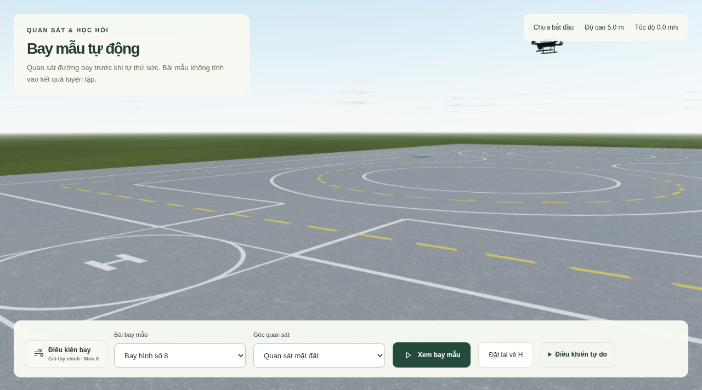
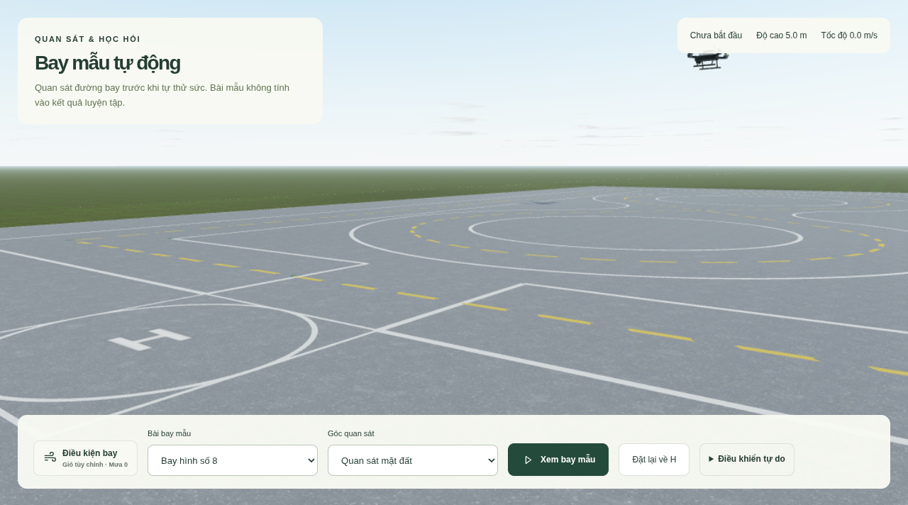
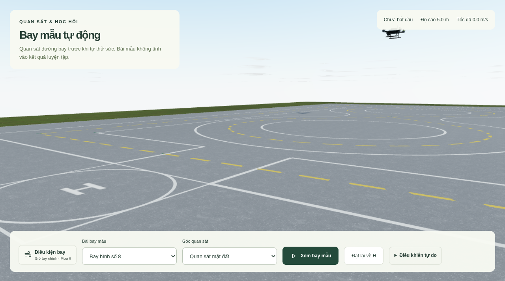
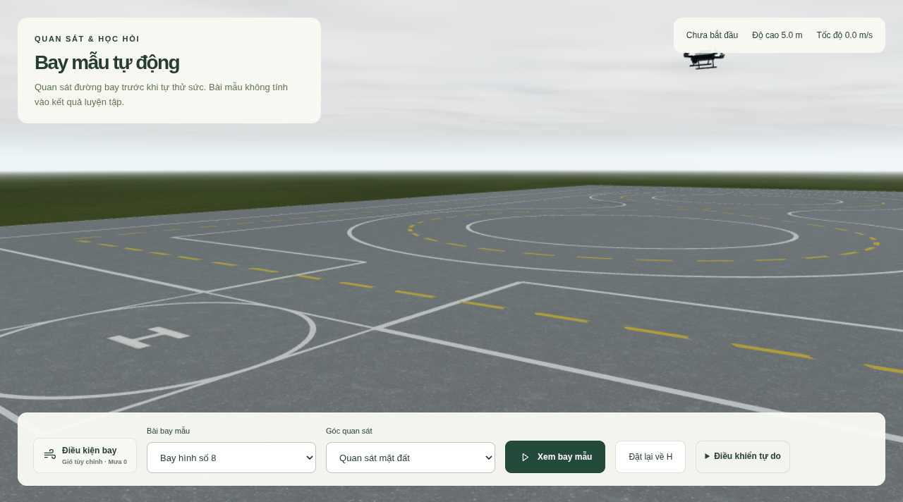
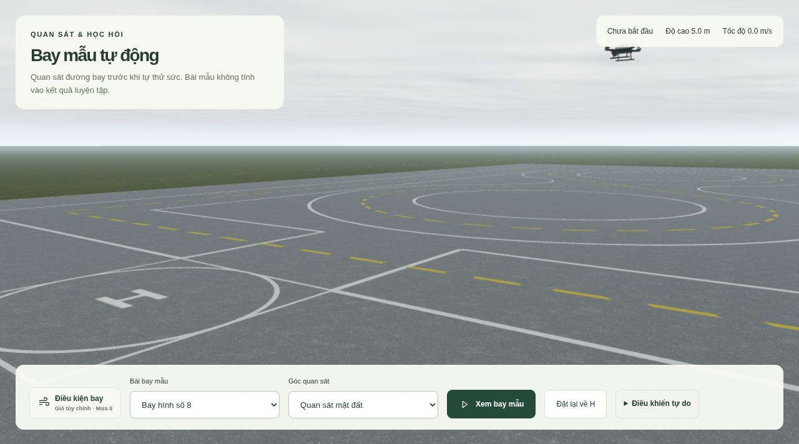
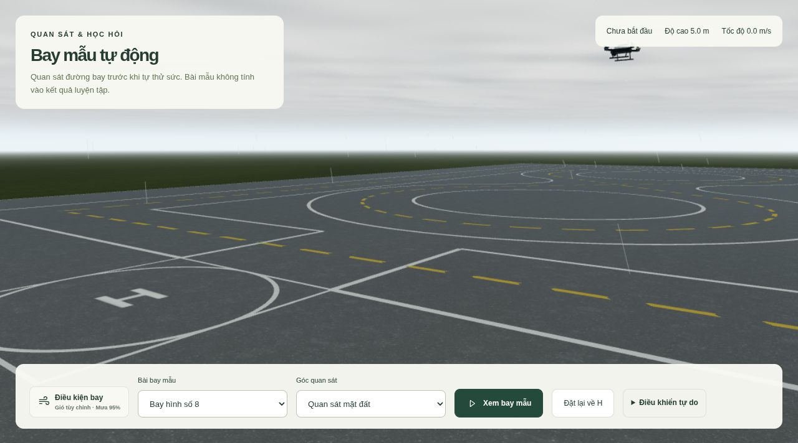
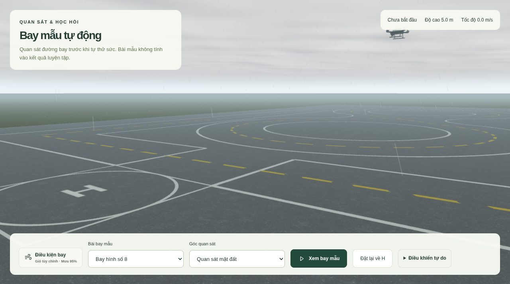

# Phase 3 interim visual comparison — diagnostic, not final art acceptance

Matched paused synthetic body-centre pose 5.32 m, 1280×800 DPR1, SwiftShader Low, unchanged camera optics/exposure. Before: accepted P2 bundle `index-C0vYNo8f.js`; after: partial P3 optical/context bundle `index-BtHTRi_Z.js`. The after set predates the later PMREM invalidation change, which does not alter visible sky/terrain shader paths. Full fixture metadata and all 85 captures per stage are in [before](before/evidence.json) and [after](after/evidence.json). The board isolates an unresolved failure and does **not** claim final quality.

## Clear Ground — horizon remains too pale and discontinuous

Before: 

After: 

The old straight alpha-terminated context line is replaced by optical terrain recession, but the independent sky path remains almost white. At x=640 the sky/turf transition still exceeds P3-D's 5% linear-luminance criterion.

## Component isolation — sky owns the pale band

Sky and clouds only: 

No clouds: 

No fog: 

No context: 

Unfaded clouds: 

These development-only variants are not production toggles. Removing the cloud horizon fade exposes streaks and is not a corrective technique.

## Overcast and heavy rain cloud states

Before overcast: 

After overcast: 

Before heavy rain: 

After heavy rain: 

The after images retain a light horizontal seam above turf; falling-rain redesign belongs to Phase 4 and was not attempted. Ground, Pilot VLOS, Overview, Follow and FPV are all present in both evidence directories. Low-sun, moving-flight video, portrait and final human art review remain pending until the approved architecture can meet the shared horizon gate.
